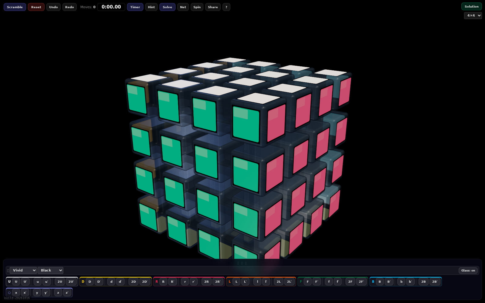
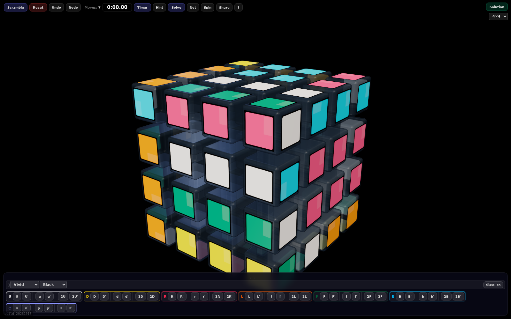
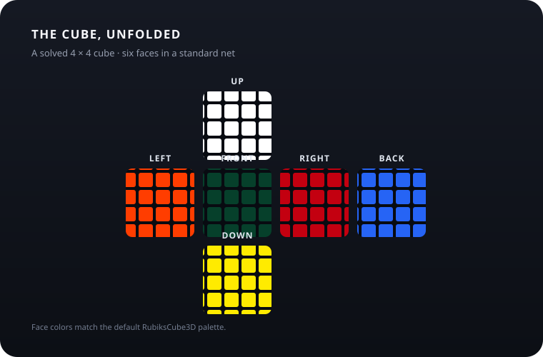

# RubiksCube3D — 3D Rubik’s Cube Simulator

### A virtual speedcube for your browser.

RubiksCube3D is a free, interactive 3D Rubik’s Cube simulator built as a browser extension. Practice on a virtual 2×2, 3×3, 4×4, 5×5, 6×6, 7×7 or 8×8 cube: turn layers with your mouse, touch screen or keyboard, generate scrambles, and track timed solves. Explore the puzzle from any angle, choose which color faces up, and use guided beginner lessons to learn the 3×3 method. The extension works offline after installation, so you can practice right from your browser toolbar.

Whether you are learning your first cube, practicing algorithms, or timing speedsolves, RubiksCube3D brings a configurable cube, scramble tool, timer and visual practice space together in one place.

  <a href="https://github.com/MohanKrishna-RC/RubiksCube3D/raw/refs/heads/main/release/rubiks-cube-extension-1.2.11.zip"><strong>⬇ Download RubiksCube3D for Chrome</strong></a>

Version 1.2.11 · Free download · No account required

## Your cube, your way

| **Pick your challenge** | **Make every turn count** |
|:--|:--|
| Play on cubes from **2×2 through 8×8**. Switch sizes whenever you want a different challenge. | Turn a face by clicking its tiles, or use familiar cube notation from the keyboard. Undo and redo moves as you practice. |
| **See the whole puzzle** | **Practice at your pace** |
| Freely rotate the cube, zoom in for a closer look, or open a 2D net view to see all six faces at once. | Generate a scramble, track your moves and use the built-in speedcubing timer with a 15-second inspection period. |

## A closer look

| **Solved** | **Scrambled** |
|:--:|:--:|
|  |  |
| Start with a clean cube and make it your own. | A seven-move scramble, captured in the 3D view. |

**The six faces, unfolded**

*The default face colors arranged in a standard 4 × 4 cube net.*

## Made for cubing

- **Interactive 3D cube:** drag the cube to rotate it freely, then scroll or pinch to zoom.
- **Six cube sizes:** choose 2×2, 3×3, 4×4, 5×5, 6×6, 7×7 or 8×8.
- **Flexible turning:** click a facelet, use keyboard notation, or make wide and inner-layer turns.
- **Scramble and practice:** generate a scramble, track move count, and undo or redo turns.
- **Hint and session solve:** reveal the inverse of your last recorded move, or step through / play the full reverse of moves made during the current session.
- **Choose any top color:** select white, yellow, green, blue, red, or orange to smoothly reorient the cube while preserving the scramble.
- **Freehand cube rotation:** drag the cube with a mouse or finger to turn it naturally in any direction; it carries a little momentum when released.
- **Comfortable default framing:** the cube starts slightly smaller to leave room for the controls around it.
- **Guided 3×3 lessons:** learn the beginner method in seven self-paced stages, with progress saved in your browser.
- **Speedcubing sessions:** use a 15-second inspection, best time, trimmed Ao5/Ao12, solve history, +2 and DNF marking.
- **2D net:** switch to a flat view of the cube’s faces.
- **Offline after installation:** the rendering engine is bundled with the extension; no account or external service is needed to play.
- **Lightweight permissions:** the extension requests access to browser tabs so its toolbar button can open the cube.

## Install

1. Download and extract the [Chrome extension ZIP](https://github.com/MohanKrishna-RC/RubiksCube3D/raw/refs/heads/main/release/rubiks-cube-extension-1.2.11.zip).
2. Open `chrome://extensions` and turn on **Developer mode**.
3. Select **Load unpacked** and choose the extracted folder containing `manifest.json`.
4. Pin the RubiksCube3D icon if you like, then click it to open the cube.

The extension is packaged for Chromium browsers that support Manifest V3, including Chrome, Edge and Brave.

## Controls

| Action | Control |
|:--|:--|
| Rotate the cube | Drag the cube |
| Zoom | Scroll or pinch |
| Turn a face | Click a facelet, or use `U D R L F B` |
| Reverse a turn | `Shift` + move key (prime notation) |
| Wide turn | `Ctrl` + move key |
| Inner-layer turn | `Alt` + move key |
| Rotate the whole cube | `X Y Z` |
| Undo / redo | `Z` / `Ctrl` + `Y` |
| Start inspection / timer | `Space` |

## Releases

Current release: **1.2.11**. Download the ZIP above, or browse the [release files](https://github.com/MohanKrishna-RC/RubiksCube3D/tree/main/release).

## Frequently asked questions

**Is RubiksCube3D free?** Yes. The extension is free to download and does not require an account.

**Which cube sizes are supported?** You can play on virtual cubes from 2×2 through 8×8, including the classic 3×3 Rubik’s Cube.

**Can I use it offline?** Yes. Once installed, the cube and its bundled 3D engine run locally in the browser without an external service.

**Does it include a Rubik’s Cube solver?** It includes move hints and can reverse the moves recorded during your current session. It does not claim to solve an arbitrary cube state.

## Feedback

Found a problem or have an idea? [Open an issue](https://github.com/MohanKrishna-RC/RubiksCube3D/issues).
